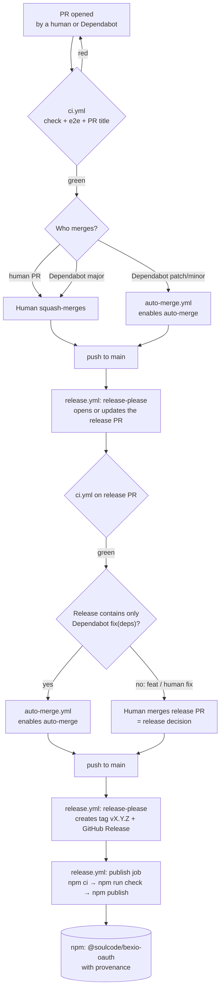
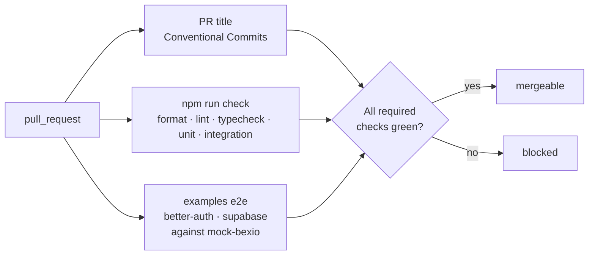
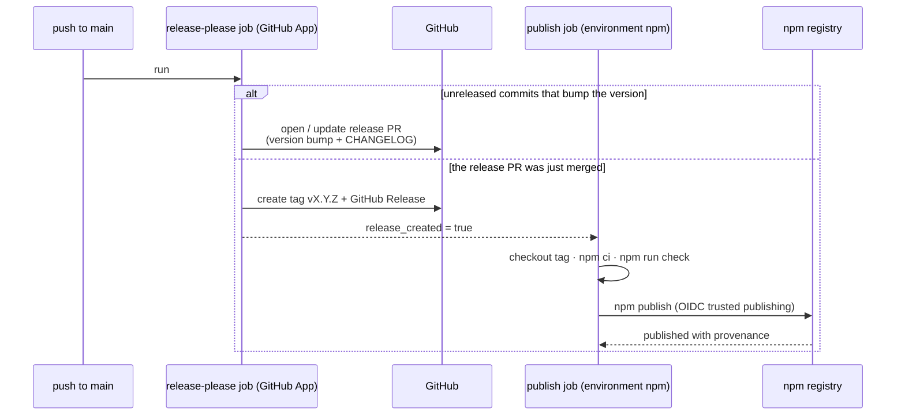
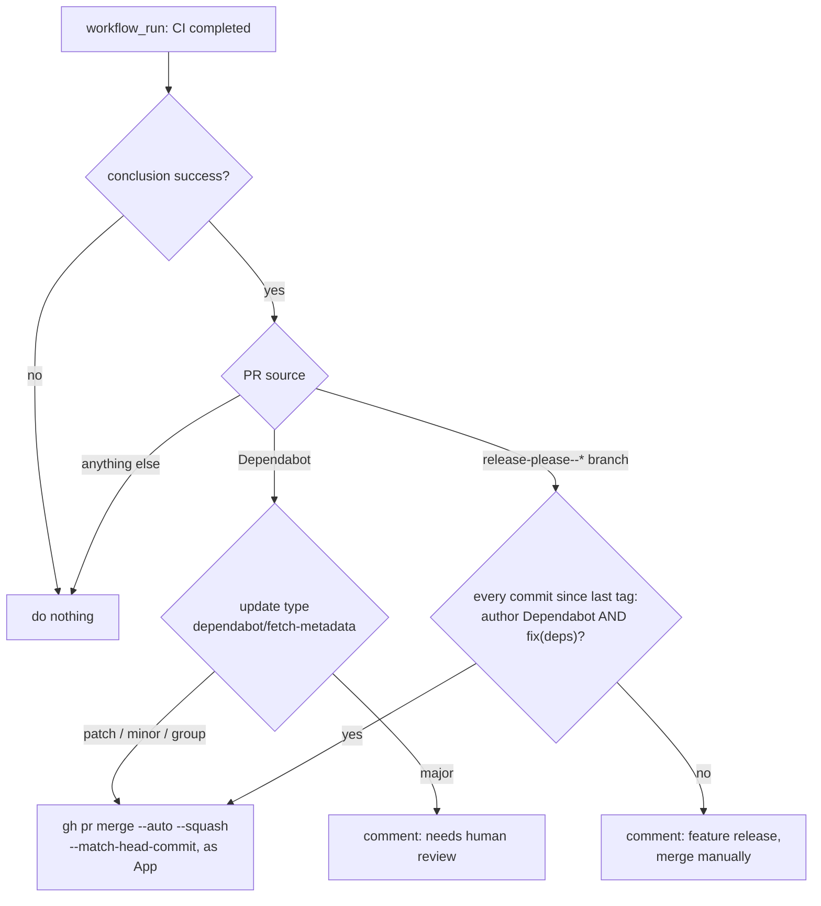
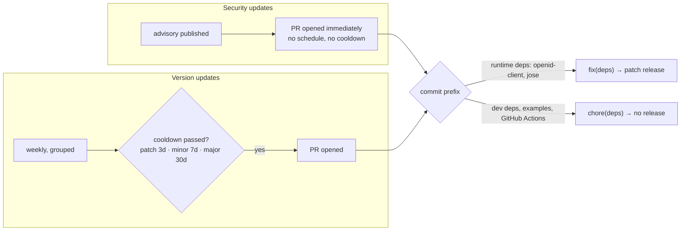

# Development guide

> **Status: draft for v0.1.** It describes the intended setup; once the workflows exist, this file becomes the reference.

How to work on `@soulcode/bexio-oauth`: repo layout, local setup, tests, and how a change travels from a pull request to npm. To _use_ the library, read the [integration guide](integration.md) instead.

---

## 1. Repo layout

```
bexio-oauth/
├── packages/bexio-oauth/     # the published package (src, sql/, CLI, README.md)
├── examples/
│   ├── _shared/mock-bexio/   # mock Bexio OIDC issuer + /3.0/permissions (private)
│   ├── better-auth/          # example app, private
│   └── supabase/             # example app, private
├── docs/                     # integration.md (spec + user guide), development.md (this file)
└── .github/
    ├── workflows/            # ci.yml, release.yml, auto-merge.yml
    └── dependabot.yml
```

npm workspaces tie it together. Only `packages/bexio-oauth` is ever published; everything under `examples/` is `"private": true`.

## 2. Local setup

Requirements: Node 24, npm 11, Docker (for Postgres and the local Supabase stack).

```bash
npm install
npm run check          # format, lint, typecheck, unit + integration tests
npm run test:e2e       # example apps against mock-bexio (starts Postgres / Supabase locally)
```

Integration and e2e tests never call the real Bexio. They use `examples/_shared/mock-bexio`. To try against real Bexio, run an example app with your own Bexio OAuth app credentials (see each example's `.env.example`).

## 3. Tests

| Layer       | Where                                   | What it covers                                                          | Needs                                                  |
| ----------- | --------------------------------------- | ----------------------------------------------------------------------- | ------------------------------------------------------ |
| Unit        | `packages/bexio-oauth/src/**/*.test.ts` | flows, errors, encryption, claim and role mapping, CLI                  | nothing                                                |
| Integration | `packages/bexio-oauth/test/`            | Postgres store, refresh lock under concurrency, rotation, `refreshIdle` | Postgres (Docker), mock-bexio                          |
| End-to-end  | `examples/*/e2e/`                       | real auth frameworks + the library, in a browser (Playwright)           | example app, mock-bexio                                |
| Manual      | `examples/README.md` checklist          | the same flows against live Bexio                                       | your Bexio app credentials; once per release candidate |

All automated layers run on every pull request. There are no nightly or scheduled test runs.

## 4. Conventions

- **Conventional Commits, enforced on PR titles.** PRs are squash-merged, so the PR title becomes the commit on `main`, and release-please reads those commits to decide the next version and write the changelog.

  | Title prefix                                                   | Effect                                                        |
  | -------------------------------------------------------------- | ------------------------------------------------------------- |
  | `feat:`                                                        | minor release (0.x: minor)                                    |
  | `fix:`, `perf:`, `fix(deps):`                                  | patch release                                                 |
  | `feat!:` / `BREAKING CHANGE:`                                  | major release (before 1.0: minor, via `bump-minor-pre-major`) |
  | `chore:`, `docs:`, `test:`, `ci:`, `refactor:`, `chore(deps):` | no release                                                    |

- **The integration guide is the spec.** A PR that changes public behavior updates `docs/integration.md` in the same PR.
- **No references to specific downstream products** in code, docs, examples or table names. Examples use "user", "workspace", "your app".

## 5. CI/CD

Three workflows:

| Workflow         | Trigger                  | Job                                                       |
| ---------------- | ------------------------ | --------------------------------------------------------- |
| `ci.yml`         | every PR, push to `main` | `npm run check`, examples e2e, PR-title check             |
| `release.yml`    | push to `main`           | release-please; publish to npm when a release was created |
| `auto-merge.yml` | CI finished successfully | auto-merge eligible Dependabot and release PRs            |

Every write to the repo (opening the release PR, merging, tagging) runs as the org's **`soulcode-automation` GitHub App**, not as `GITHUB_TOKEN`. GitHub starts no workflows from events made with `GITHUB_TOKEN`: CI would never run on the release PR, and a merge would never trigger `release.yml`. The App's client id is the repo variable `SC_AUTOMATION_CLIENT_ID`; its private key is the secret `SC_AUTOMATION_PRIVATE_KEY`. Forks need their own App, or they can skip releasing altogether.

### 5.1 The whole path, from PR to npm



### 5.2 Pull request checks (`ci.yml`)



The `main` ruleset requires all three checks, allows squash merges only, and blocks direct pushes (except release-please's own release branch, via the App). Auto-merge can never skip a check: it only asks GitHub to merge _once the required checks pass_.

### 5.3 Release (`release.yml`)



- Both jobs live in **one** workflow on purpose. A separate "on release" workflow would never fire, because the release is created by automation. npm's trusted publisher is also bound to exactly this filename (`release.yml`) and environment (`npm`).
- The publish job re-runs the full check on the tagged commit, so what ships is what was tested.
- There is **no npm token** anywhere. npm trusts the GitHub Actions OIDC identity of `release.yml` in the `npm` environment. Provenance shows on the npm package page and links back to the exact workflow run.
- Concurrency group `release`, never cancelled in progress, so two quick merges can't race on the release branch.
- Least-privilege permissions per job: release-please gets `contents: write` and `pull-requests: write` (through the App token); publish gets `contents: read` and `id-token: write`. Trusted publishing needs npm CLI ≥ 11.5.1, so the job upgrades npm if the bundled one is older.
- release-please config (`release-please-config.json` + manifest):
  - one package, `packages/bexio-oauth`;
  - tags `vX.Y.Z` (`include-component-in-tag: false`);
  - `bump-minor-pre-major: true`.

  Changes only under `examples/`, `docs/` or `.github/` never cut a release. The README published to npm is `packages/bexio-oauth/README.md`; the root README links to it.

### 5.4 Auto-merge (`auto-merge.yml`)



- **Why `workflow_run` and not `pull_request`:** a run triggered by Dependabot on `pull_request` gets a read-only token and no regular secrets. `workflow_run` runs in the default-branch context, so the App key and the normal permissions are available.
- **`--match-head-commit`** merges only the commit CI just checked. A new push to the PR cancels it.
- **The human gate:** release PRs containing a `feat`, a human-written `fix` or a breaking change are never auto-merged. Merging those is the release decision. Releases made up only of dependency fixes (typically security updates) ship without waiting for anyone.

### 5.5 Dependabot



Version updates are grouped weekly. GitHub Actions are pinned by commit SHA and updated by Dependabot as well.

The cooldown is supply-chain protection. An auto-merged, auto-published dependency bump reaches our users quickly, so routine updates wait long enough for a compromised release to be caught and pulled first. Security updates skip the wait on purpose.

Our users resolve `openid-client` and `jose` within our version ranges anyway (lockfiles aren't published). A `fix(deps)` release mainly **raises the minimum version**, which makes sure nobody installing our latest release gets a vulnerable dependency.

## 6. Releasing by hand

You don't. Merging the release PR is the only manual step, and only for feature releases. One exception: the **very first** version (`0.1.0`) is published once by a maintainer, because npm's trusted-publisher setting only exists once the package exists:

```bash
git checkout v0.1.0
npm ci && npm run check
npm publish -w packages/bexio-oauth --access public   # with 2FA
```

Then, on npmjs.com → package → Settings:

1. Add a trusted publisher: GitHub Actions, repo `SoulcodeAgency/bexio-oauth`, workflow `release.yml`, environment `npm`.
2. Set publishing access to **"Require two-factor authentication and disallow tokens"**.

Every release after that is automated.

## 7. Repository settings checklist

- [ ] Repository is public (provenance requires it).
- [ ] `soulcode-automation` App installed on the repo (contents + pull-requests write); variable `SC_AUTOMATION_CLIENT_ID`, secret `SC_AUTOMATION_PRIVATE_KEY`.
- [ ] "Allow auto-merge" enabled; "Dependabot security updates" enabled.
- [ ] Environment `npm`, deployment branches restricted to `main`.
- [ ] `main` ruleset: PRs only, squash only, required checks (`check`, `e2e`, `pr-title`), the App allowed to bypass for the release branch.
- [ ] npm: trusted publisher configured, tokens disallowed (after the bootstrap publish).
