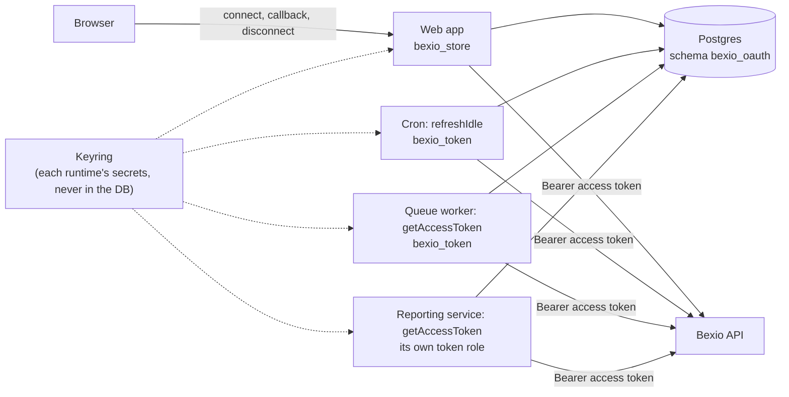

# `@soulcode/bexio-oauth`: integration guide

> **Status: v0.1.** This guide is the reference for the public API. It started as the spec, and a PR that changes public behavior updates it in the same PR.

This guide is for developers and coding agents integrating Bexio OAuth into an app. It explains the concepts, every public function, the database setup, the security model and the reasoning behind the design. The [package README](../packages/bexio-oauth/README.md) is the short version; [§16](#16-api-reference) lists every export.

---

## 1. What this library does, and what it doesn't

**It holds and refreshes Bexio OAuth tokens for your app ("token custody").** Bexio uses OpenID Connect (Keycloak). After a user authorizes your app, you get an access token (short-lived) and a refresh token (long-lived, rotates on every use). This library:

- runs the **"Connect Bexio" flow**: redirect to Bexio, handle the callback, store the result;
- stores tokens **encrypted** in your Postgres database;
- hands out a **valid access token** on demand and refreshes it when needed. This works from request handlers and from background jobs alike, and stays safe when many server instances refresh at once;
- tells you **who** connected (Bexio user, company, admin or member).

**It does not manage users, sessions or login.** That's your auth framework's job (Supabase Auth, Better Auth, Auth.js, …). If you want "Sign in with Bexio", your auth framework runs the login, and you hand the resulting tokens to this library with `saveGrant()`. See [§8](#8-sign-in-with-bexio).

**It is not a Bexio API client.** It gives you an access token; call the Bexio API with `fetch` or the client of your choice.

## 2. Concepts

### Connection and grant

A **connection** is one Bexio authorization stored by the library: the tokens of one **Bexio identity**, plus who that is. A Bexio identity is a **(Bexio company, Bexio user)** pair, because Bexio issues tokens per company. A user with access to three companies who connects all three has three connections.

A **grant** is one owner's access to a connection. It is what your app works with: `listGrants` returns grants, and `getAccessToken` and `disconnect` select one. A grant shows its connection's company, user, role and status, without token material.

### Owner

Every grant belongs to an **owner**, an opaque string **your app** chooses: a user id, a workspace id, a tenant id. The library never interprets it.

A grant is unique per **(owner, connection)**:

- Reconnecting the same Bexio user and company for the same owner **replaces** the connection's tokens. The grant stays.
- Two owners may connect the same Bexio user and company. They get **separate grants on one shared connection**: one set of tokens, refreshed once for both. Disconnecting one owner keeps the other working ([§10](#10-disconnect-and-re-authorization)).

| Your app's model                                        | Typical `ownerId`                    |
| ------------------------------------------------------- | ------------------------------------ |
| Each user connects their own Bexio                      | the user's id                        |
| A workspace connects Bexio once, everyone in it uses it | the workspace id                     |
| "Sign in with Bexio"                                    | the user's id in your auth framework |

### Why owners of the same identity share a connection

Bexio's identity provider (Keycloak) keeps **one valid refresh token chain per Bexio user, company and OAuth client**. Every new authorization of the same user and company through the same client starts a new chain and invalidates the refresh tokens issued before it: the next refresh with an older token fails with `invalid_grant` ("Refresh token issued before the user session started"). Revocation reaches further: revoking any of a user's refresh tokens ends **all of that user's chains for the client**, for every company, even when the revoked token is itself stale.

If two owners kept their own copies of the tokens, connecting the second owner would break the first at its next refresh, and disconnecting either would log out the other. With one connection per identity, the latest authorization's tokens serve every owner, a refresh happens once for all of them, and only the last owner's disconnect revokes the chain.

> [!IMPORTANT]
> **Use one Bexio OAuth client per app.** The chain belongs to the Bexio user and the OAuth client, not to your app. Two apps (or two environments) that share a client id invalidate each other's grants for the same Bexio user whenever one of them connects, and a disconnect in one revokes the other's chain. Register a separate OAuth app at Bexio for each app and each environment that holds real grants.

### Role

Each connection records the Bexio user's **role** in that company: `admin` or `member`. It is read from Bexio's `/3.0/permissions` on every connect and on every token refresh. Use it to gate admin features without an extra API call.

### Status

`active`, or `reauth_required` when Bexio rejected the refresh token (the user revoked access, the session idled out, the password was reset, or the user authorized another app with the same OAuth client). Status belongs to the connection, so every owner of it sees the same one. A `reauth_required` connection stays in the table so your UI can show "reconnect", until one of its owners reconnects (which makes it `active` for all of them) or the last one disconnects.

## 3. Requirements and install

- Node.js ≥ 24, ESM.
- PostgreSQL 13 or later (any host: self-hosted, Supabase, or another managed Postgres) reached through a driver that matches [`SqlClient`](#sqlclient). Setting it up once needs a role that may create schemas and roles ([§4](#4-database-setup)); your app then runs with a role that can't.
- A Bexio OAuth app (client id and secret) from the Bexio developer portal, with your callback URL registered as a redirect URI.

```bash
npm install @soulcode/bexio-oauth pg
```

Runtime dependencies: [`openid-client`](https://github.com/panva/openid-client) and [`jose`](https://github.com/panva/jose). Nothing else.

## 4. Database setup

The library uses **two tables**: `bexio_connections` (the tokens, one row per Bexio identity) and `bexio_grants` (one row per owner of a connection). They live in their own schema, **`bexio_oauth`**, and your app reaches them through its own login role, **`bexio_store`**, which can reach those two tables and nothing else. Runtimes that only use tokens can get an even narrower role, **`bexio_token`** ([below](#runtimes-that-only-use-tokens-the-token-role)). You create all of it with your own migration tool. The library never runs migrations itself.

### What the SQL sets up

`npx @soulcode/bexio-oauth sql` prints this setup. It is the one the library is built and tested for:

| Object                        | What it is                                                                                                                                                                                                                                                                                               |
| ----------------------------- | -------------------------------------------------------------------------------------------------------------------------------------------------------------------------------------------------------------------------------------------------------------------------------------------------------- |
| schema `bexio_oauth`          | Holds the two tables. Not `public`, so platform APIs that serve `public` (Supabase's Data API) don't serve it.                                                                                                                                                                                           |
| role `bexio_store`            | `LOGIN NOINHERIT`, created without a password ([set one](#passwords-and-connection-strings)). `USAGE` on the schema, `SELECT, INSERT, UPDATE, DELETE` on the two tables, nothing else. `postgresStore` connects as it.                                                                                   |
| revokes                       | `PUBLIC`, and Supabase's `anon`, `authenticated` and `service_role` where they exist, get no access to the schema or the tables.                                                                                                                                                                         |
| row-level security            | On for both tables, with a policy per role, named after it. The roles are neither the tables' owner nor `BYPASSRLS`, so RLS without a policy would deny them every row; any other role that is ever granted access sees none (the owner, superusers and `BYPASSRLS` roles excepted, as always with RLS). |
| role `bexio_token` (optional) | `--token-role bexio_token`: reads both tables and updates only a connection's token, lock, role and status columns.                                                                                                                                                                                      |

What it protects against:

- **A leaked server environment gives away two tables of ciphertext, not your database.** The credentials in your app's env can read the encrypted token rows and nothing else: no other table, no other schema, and they don't bypass RLS. Without the keyring ([§5](#encryption-keys)), which never lives in the database, the rows are useless.
- **The service-role key gets nothing.** The schema isn't exposed through Supabase's Data API, and `service_role` has no privileges on it, even though it bypasses RLS.
- **API roles can't read the schema.** `anon` and `authenticated` have no `USAGE` on it; a signed-in user's JWT reaches nothing.
- **Correctness never depends on `search_path`.** The store names the schema in every statement, so it works through transaction-mode poolers that don't apply role settings, and no object of the same name earlier in the path can shadow the tables.
- **With the token role:** a leaked credential of a runtime that only uses tokens can't add or delete grants or connections, and can't change whose tokens a connection holds (the identity columns). It can still damage what it may write: overwrite or invalidate the tokens (everyone then reconnects), mark a connection `reauth_required`, or change its stored `role`. Don't treat `role` as authorization for anything a token-role runtime shouldn't be able to grant itself.

### The CLI

The package ships its schema as numbered SQL files and a small command that prints them:

```bash
npx @soulcode/bexio-oauth sql                            # schema, tables, bexio_store role
npx @soulcode/bexio-oauth sql --token-role bexio_token   # … plus the token role (recommended, see below)
npx @soulcode/bexio-oauth sql --from 2                   # only migrations 0002 onwards (for upgrades)
npx @soulcode/bexio-oauth keygen                         # a new random 32-byte encryption key (base64url)
```

| Option                | Default       | Notes                                                                                                                         |
| --------------------- | ------------- | ----------------------------------------------------------------------------------------------------------------------------- |
| `--schema <name>`     | `bexio_oauth` | Pass the same name to `postgresStore(sql, { schema })`. `public` is refused: the revokes would lock your API roles out of it. |
| `--store-role <name>` | `bexio_store` | The role `postgresStore` connects as.                                                                                         |
| `--token-role <name>` | none          | Also create the token role. Conventionally `bexio_token`.                                                                     |
| `--from <n>`          | `1`           | Only migration `<n>` onwards. Combine with the same names you used before.                                                    |

Names must be lowercase Postgres identifiers (`a-z`, `0-9`, `_`, at most 63 characters, not starting with a digit or `pg_`); anything else fails before any SQL is printed. `migrations({ schema, storeRole, tokenRole })` returns the same SQL in code.

What it is for:

- **The SQL always matches the version you installed.** Copying SQL from a README or a blog post can give you a schema for a different version. The CLI reads the files bundled in _your_ `node_modules`.
- **It plugs into any migration tool.** It only writes to stdout, so you redirect it into a new migration file and your tool takes it from there:

  ```bash
  # Supabase CLI
  npx @soulcode/bexio-oauth sql --token-role bexio_token > supabase/migrations/20261024120000_bexio_oauth.sql
  # Plain SQL migrations (dbmate, node-pg-migrate in SQL mode, Flyway, …)
  npx @soulcode/bexio-oauth sql --token-role bexio_token > db/migrations/20261024120000_bexio_oauth.sql
  # Or apply directly
  npx @soulcode/bexio-oauth sql --token-role bexio_token | psql "$DATABASE_URL"
  ```

- **It is idempotent.** The output applies twice in a row without error: schema, roles, revokes, grants, policies and tables alike. Roles are cluster-wide and survive a database reset, so they are created only if missing.
- **Upgrades are explicit.** When a new version adds a migration, the changelog says so, and `sql --from <n>` (with the names you used) prints just the new part for your next migration file, including the grants and policies for anything it adds.
- **`keygen`** saves you from hand-rolling a random key (see [§5](#encryption-keys)).

Run the migration as a role that may create schemas and roles: the database owner, or `postgres` on Supabase. That role owns the tables; your app never uses it.

The SQL files are also in the package at `node_modules/@soulcode/bexio-oauth/sql/`, written with the default names, if you'd rather copy them by hand: `0001_bexio_oauth.sql`, and `0001_bexio_oauth.token-role.sql` for the token role. The CLI is a convenience, not a requirement.

`migrations()` returns the same SQL embedded in the library's JavaScript, not read from disk, so it works unchanged when your bundler inlines the library (for example in Next.js route handlers or server actions, without adding it to `serverExternalPackages`).

### Passwords and connection strings

The roles are created **without a password**, so nobody can log in as them with password authentication yet (a `trust` entry in `pg_hba.conf`, common in local Docker setups, lets anyone in regardless). Set one per environment, out of band (a SQL console, your secret manager's rotation job), never in a migration file, where it would end up in version control:

```sql
ALTER ROLE bexio_store PASSWORD '<long random value>';
ALTER ROLE bexio_token PASSWORD '<another one>';   -- if you created it
```

For local development a seed file is fine (the [Supabase example](../examples/supabase/supabase/seed.sql) does that). Then point your app at the role:

```bash
# Plain Postgres
DATABASE_URL=postgres://bexio_store:<password>@db.example.com:5432/app
# Supabase, transaction pooler (Supavisor): the user is <role>.<project-ref>
DATABASE_URL=postgresql://bexio_store.<project-ref>:<password>@<pooler-host>:6543/postgres
```

```ts
const pool = new Pool({ connectionString: process.env.DATABASE_URL }); // as bexio_store
const store = postgresStore(pool); // tables in bexio_oauth; with --schema, pass { schema }
```

The role's default `search_path` doesn't include `bexio_oauth`, and doesn't need to: the store names the schema in every statement. If you query the tables by hand and want short names, you can add it yourself (optional, not emitted by the CLI):

```sql
ALTER ROLE bexio_store SET search_path = bexio_oauth;
```

If your app also needs a database login for its own tables (an auth framework, your domain data), give that its own connection. The store's role can't read them, and your app's role doesn't need the tokens.

### Runtimes that only use tokens: the token role

`getAccessToken`, `listGrants` and `refreshIdle` never insert or delete. They read both tables and update a connection's tokens, its refresh lock and its status. The token role has exactly that:

| Table               | `bexio_token` may                                                                                                                                                                                            |
| ------------------- | ------------------------------------------------------------------------------------------------------------------------------------------------------------------------------------------------------------ |
| `bexio_connections` | `SELECT`; `UPDATE` of `access_token`, `refresh_token`, `access_expires_at`, `refresh_expires_at`, `scope`, `role`, `status`, `refresh_locked_until`, `refresh_lock_token`, `last_refreshed_at`, `updated_at` |
| `bexio_grants`      | `SELECT`                                                                                                                                                                                                     |

With it, `callback`, `handleCallback`, `saveGrant` and `disconnect` fail with Postgres's `permission denied` (SQLSTATE `42501`), thrown as is (`start` never touches the database, but its flow can only finish in a runtime with `bexio_store`). Everything else works the same, refresh coordination included.

**Recommended:** whenever a runtime only uses tokens (a cron job, a queue worker, a separate API service, a scheduled function), create the token role and give that runtime its credentials instead of `bexio_store`'s. Configure it like any other client (same keyring, same Bexio client); only the connection string differs:

```ts
// worker/bexio.ts: a runtime that only calls getAccessToken / refreshIdle
export const bexio = createBexioOAuth({
  ...sharedConfig, // clientId, clientSecret, redirectUri, scopes, keys
  store: postgresStore(
    new Pool({ connectionString: process.env.BEXIO_TOKEN_DATABASE_URL }),
  ),
});
```

Added it later? Apply `sql --token-role bexio_token` as a new migration: everything in it is idempotent. Several services that each should have their own login can get their own token roles the same way (`--token-role billing_bexio`, then `--token-role sync_bexio`): each role's policies are named after it, so adding one leaves the others' access intact.

### Architecture examples

**One app does everything** (connect UI, API calls and the `refreshIdle` cron in one deployment): one login, `bexio_store`. Nothing else to do.

**A web app plus background runtimes.** The web app runs the connect flow and disconnects, so it holds `bexio_store`. Workers, cron jobs and other services only use tokens and hold `bexio_token`. A leaked worker secret then can't attach a Bexio account to anyone or delete connections:



Every runtime needs the keyring too: it decrypts the tokens it reads and encrypts the ones it refreshes.

**Runtimes that shouldn't hold any database login** (browsers, untrusted edge code, third-party integrations): don't hand them a role. Let a service that has one call `getAccessToken` and expose only what they need through your own authenticated API.

**Several environments or apps on one Postgres cluster.** Roles are cluster-wide, so two databases on one cluster share one `bexio_store`, and one password, unless you name them apart. Give each environment its own roles, and each app sharing a database its own schema:

```bash
npx @soulcode/bexio-oauth sql --store-role bexio_store_staging --token-role bexio_token_staging
npx @soulcode/bexio-oauth sql --schema bexio_oauth_billing --store-role bexio_store_billing
```

and pass the schema to the store: `postgresStore(pool, { schema: "bexio_oauth_billing" })`. Each environment also needs its own Bexio OAuth client ([§2](#why-owners-of-the-same-identity-share-a-connection)).

### Supabase

- **Migration:** `npx @soulcode/bexio-oauth sql --token-role bexio_token > supabase/migrations/<timestamp>_bexio_oauth.sql`. It needs no Supabase-specific edits: it revokes `anon`, `authenticated` and `service_role` because they exist, and enables RLS with policies for your roles only.
- **Passwords:** once per project, in the SQL editor (`ALTER ROLE bexio_store PASSWORD '…'`). Locally, put it in `supabase/seed.sql`, which runs after the migrations on the first `supabase start` and on every `supabase db reset`.
- **Connection:** through the Supavisor **transaction pooler** (port 6543) as `bexio_store.<project-ref>`, or the direct connection as `bexio_store`. Custom `LOGIN` roles need no pooler registration. Not supabase-js: the library needs real SQL for its atomic refresh lock.
- **Data API:** keep `bexio_oauth` out of the exposed schemas (Project settings → Data API → Exposed schemas). It isn't exposed unless you add it.

### `SqlClient`

The store needs a single method:

```ts
interface SqlClient {
  query(text: string, params?: unknown[]): Promise<{ rows: unknown[] }>;
}
```

A `pg` `Pool` or `Client` matches this as is. For other drivers, write a few lines of wrapper:

```ts
// postgres.js
import postgres from "postgres";
const sql = postgres(process.env.DATABASE_URL!);
const client = {
  query: async (text, params = []) => ({
    rows: await sql.unsafe(text, params),
  }),
};
```

Every store operation is **one SQL statement**, so the library works with transaction-mode poolers and HTTP-based drivers. A disconnect relies on the driver reporting Postgres's SQLSTATE as the error's `code` (`pg`, postgres.js and the common HTTP drivers do), see [§10](#10-disconnect-and-re-authorization).

## 5. Configuration

```ts
// lib/bexio.ts (server-only)
import { Pool } from "pg";
import { createBexioOAuth, postgresStore } from "@soulcode/bexio-oauth";

// Connects as bexio_store, which reaches the bexio_oauth schema only (§4).
const pool = new Pool({ connectionString: process.env.DATABASE_URL });

export const bexio = createBexioOAuth({
  clientId: process.env.BEXIO_CLIENT_ID!,
  clientSecret: process.env.BEXIO_CLIENT_SECRET!,
  redirectUri: process.env.BEXIO_REDIRECT_URI!, // e.g. https://app.example.com/api/bexio/callback
  scopes: ["accounting", "contact_show"], // the Bexio API scopes your app needs
  keys: JSON.parse(process.env.BEXIO_TOKEN_KEYS!), // { "current": "k1", "keys": { "k1": "<base64url>" } }
  store: postgresStore(pool),
});
```

| Option                     | Required | Notes                                                                                                                                                       |
| -------------------------- | -------- | ----------------------------------------------------------------------------------------------------------------------------------------------------------- |
| `clientId`, `clientSecret` | yes      | From your Bexio OAuth app.                                                                                                                                  |
| `redirectUri`              | yes      | Must exactly match a redirect URI registered at Bexio. `https`, or plain `http` on a loopback host (`localhost`, `127.0.0.1`) for local development.        |
| `scopes`                   | no       | Bexio API scopes. Always added: `openid profile email company_profile offline_access`. `offline_access` is what makes background refresh possible.          |
| `keys`                     | yes      | Encryption keyring, see below.                                                                                                                              |
| `store`                    | yes      | `postgresStore(sqlClient, { schema? })` (schema default `bexio_oauth`, see §4) or `memoryStore()` (tests only).                                             |
| `issuer`, `apiBaseUrl`     | no       | Default to Bexio's production URLs. Override only to point at a mock in tests. Plain `http` is accepted only for loopback hosts (`localhost`, `127.0.0.1`). |
| `refreshLockTtl`           | no       | Default and minimum `"30s"`. See [§10](#refresh-coordination).                                                                                              |
| `defaultReturnTo`          | no       | Where `callback` redirects when it can't read `returnTo` from the flow cookie. Default `"/"`.                                                               |
| `fetch`                    | no       | Custom `fetch` used for every request to Bexio (proxies, tests).                                                                                            |
| `clock`                    | no       | `() => Date`, for tests that move time forward.                                                                                                             |

Durations accept milliseconds or strings like `"30s"`, `"15m"`, `"12h"`, `"7d"`. Invalid config throws `invalid_config` when you call `createBexioOAuth`.

The library **never reads environment variables itself**. You pass everything in, so it's obvious what it uses and it works in any runtime.

### Encryption keys

Tokens are encrypted with a key from your keyring. Generate a key:

```bash
npx @soulcode/bexio-oauth keygen
```

and store the keyring as one env var:

```bash
BEXIO_TOKEN_KEYS='{"current":"k1","keys":{"k1":"<output of keygen>"}}'
```

Each key must be exactly what `keygen` prints: 32 bytes as unpadded base64url, 43 characters. Anything else (padding, a stray quote, the standard base64 alphabet) is refused with `invalid_config` at startup, because a lenient decode could accept a mangled key that then differs between environments.

**Rotating a key:** add a new key and point `current` at it, keeping the old one:

```bash
BEXIO_TOKEN_KEYS='{"current":"k2","keys":{"k1":"…","k2":"…"}}'
```

New writes use `k2`; rows encrypted with `k1` still decrypt. Every refresh re-encrypts with the current key, and every active connection is refreshed at least once per `refreshIdle` window (see [§9](#9-background-jobs)). So once one `idleFor` period has passed, only `reauth_required` connections still use `k1`. Remove `k1` after those are reconnected or disconnected.

## 6. Connect Bexio

Two route handlers. Both take and return web-standard `Request`/`Response`, so they work as Next.js route handlers as-is and in any framework that speaks Fetch API.

```ts
// app/api/bexio/connect/route.ts
import { bexio } from "@/lib/bexio";
import { requireWorkspace } from "@/lib/auth"; // your app's auth

export async function GET(request: Request) {
  const workspace = await requireWorkspace(request);
  return bexio.start({
    ownerId: workspace.id,
    returnTo: "/settings/bexio",
  });
}
```

```ts
// app/api/bexio/callback/route.ts  ← this URL is your redirectUri
import { bexio } from "@/lib/bexio";
import { requireWorkspace } from "@/lib/auth";

export async function GET(request: Request) {
  const workspace = await requireWorkspace(request);
  return bexio.callback(request, { ownerId: workspace.id });
}
```

What happens:

1. `start({ ownerId, returnTo? })` needs nothing from the request; it returns the redirect `Response`. It creates a random `state`, a PKCE verifier and a `nonce`, stores them with `ownerId` and `returnTo` in an **encrypted, HttpOnly cookie** named `bexio_oauth_flow` (10 minutes, scoped to the callback path), and redirects to Bexio. `returnTo` must be a relative path (`/settings`); anything else throws `invalid_config`, so it can't be abused as an open redirect.
2. The user logs in at Bexio, picks a company and consents.
3. `callback` reads the cookie, checks `state`, **checks that the `ownerId` you pass now equals the one from `start`**, exchanges the code (PKCE), verifies the ID token (signature, issuer, audience, nonce), reads the user's role, saves the connection and the owner's grant on it (one statement), deletes the cookie, and redirects to `returnTo`.
4. On failure it redirects to `returnTo?bexio_error=<code>` (see [§11](#11-errors)) and saves nothing.

**Connecting a second owner updates the first.** If another owner already connected the same Bexio user and company, the new tokens replace the shared connection's tokens: that is required, because Bexio has just invalidated the older refresh token ([§2](#why-owners-of-the-same-identity-share-a-connection)). Every owner of the connection uses the new tokens from then on, and a `reauth_required` connection becomes `active` again for all of them.

When two owners connect the same identity at nearly the same time, the **newer authorization wins**, not the later database write: each connect makes a few more calls to Bexio after its code exchange, so the older authorization's save can arrive last. The connection stores when Bexio issued its tokens (the access token's `iat`) and only takes tokens at least as new. The other owner's grant is linked either way.

**One callback for many owners.** If your callback URL can't tell which workspace the flow was for (the redirect URI is fixed), pass `authorizeOwner` instead of `ownerId`. It receives the owner recorded at `start` and returns whether the signed-in user may connect Bexio for it:

```ts
export async function GET(request: Request) {
  const user = await requireUser(request);
  return bexio.callback(request, {
    authorizeOwner: (ownerId) => isWorkspaceAdmin(user, ownerId),
  });
}
```

Why the `ownerId` check matters: without it, an attacker could start a flow for their own workspace, trick a victim into finishing it, and attach the victim's Bexio account to the attacker's workspace (connection CSRF). Always derive `ownerId` from your authenticated session, never from the query string, or check it with `authorizeOwner`.

Need the grant itself instead of a redirect (for example in an API)? Use `bexio.handleCallback(request, { ownerId })`. It returns `{ grant, returnTo, headers }` or throws a `BexioOAuthError`. Copy `headers` (a `Set-Cookie` that deletes the flow cookie) onto your response.

The callback rebuilds the token request on your configured `redirectUri`, so a reverse proxy that rewrites the host doesn't break the code exchange.

## 7. Using the token

```ts
const { accessToken } = await bexio.getAccessToken({ ownerId: workspace.id });

const res = await fetch("https://api.bexio.com/2.0/contact", {
  headers: {
    Authorization: `Bearer ${accessToken}`,
    Accept: "application/json",
  },
});
```

- If the stored access token is still valid (with a safety margin), it is returned without any network call.
- If it expired, the library refreshes it, stores the new **rotated** refresh token, and returns the new access token. The refresh happens on the connection, so an owner whose sibling just refreshed gets the fresh token without calling Bexio.
- It returns `{ accessToken, expiresAt, grant }`.
- An owner with several grants (several companies) must say which: `getAccessToken({ ownerId, companyId })`, or `{ ownerId, grantId }` for one specific grant (e.g. two Bexio users of the same company). Without either you get `ambiguous_grant`.
- List an owner's grants (no token material) for a "connected companies" screen:

```ts
const grants = await bexio.listGrants({ ownerId: workspace.id });
// [{ id, ownerId, connectionId, companyId, companyName, userId, userName, userEmail,
//    companyUserId, role, status, scope, accessExpiresAt, lastRefreshedAt, createdAt, updatedAt }]
```

`id`, `ownerId` and `createdAt` (when this owner connected) belong to the grant; everything else to its connection. Grants of the same Bexio identity have the same `connectionId`.

Don't cache access tokens yourself. `getAccessToken` is cheap when the token is valid (one indexed `SELECT`), and the library has to see every refresh to keep the rotation consistent.

## 8. Sign in with Bexio

Let your auth framework run the login with Bexio as an OIDC provider (issuer `https://auth.bexio.com/realms/bexio`, scopes including `offline_access` and `company_profile`). In its callback, pass the provider's tokens to the library:

```ts
await bexio.saveGrant({
  ownerId: user.id, // your auth framework's user id
  tokens: { accessToken, refreshToken, idToken, expiresAt },
});
```

`saveGrant` verifies before trusting any claim: the access token's (and, if given, the ID token's) signature against Bexio's published keys, the issuer, expiry, that it really is an access token issued to **your** client (`azp` must equal your `clientId`; ID tokens are refused), and that both tokens belong to the same user. Bexio's access token carries only ids (`sub`, `company_id`, `company_user_id`); the company name, email and person name come from the ID token. Without one (some frameworks, Supabase Auth among them, only pass the access token), `saveGrant` reads them from Bexio's userinfo endpoint. Then it saves the connection and the grant exactly like `callback` would, including updating a connection other owners share ([§6](#6-connect-bexio)), and returns the grant. From then on, use `getAccessToken({ ownerId: user.id })` as usual.

`expiresAt` is optional; it defaults to the access token's `exp` claim.

Working setups live in [`examples/`](../examples) ([findings and how to run them](../examples/README.md)):

| Example                                           | Auth framework                               | Sign in with Bexio                                                                                                                                                                                                                                                                                                                                                                                                                                                                    | Also shows                                                                                                                      |
| ------------------------------------------------- | -------------------------------------------- | ------------------------------------------------------------------------------------------------------------------------------------------------------------------------------------------------------------------------------------------------------------------------------------------------------------------------------------------------------------------------------------------------------------------------------------------------------------------------------------- | ------------------------------------------------------------------------------------------------------------------------------- |
| [`examples/better-auth`](../examples/better-auth) | Better Auth (`genericOAuth`, plain Postgres) | **Yes, e2e-tested.** Better Auth stores the provider tokens (refresh token included) on its `account` row; a `hooks.after` handler passes them to `saveGrant()` and clears that copy ([`lib/auth.ts`](../examples/better-auth/lib/auth.ts)).                                                                                                                                                                                                                                          | Connect Bexio for workspaces with `authorizeOwner`, a background job, the `refreshIdle` cron, reconnect after `reauth_required` |
| [`examples/supabase`](../examples/supabase)       | Supabase Auth                                | **Yes, validated against live Bexio; not in the automated tests.** A custom OIDC provider (`custom:bexio`) hands `provider_token` / `provider_refresh_token` to [`app/auth/callback/route.ts`](../examples/supabase/app/auth/callback/route.ts), which passes them to `saveGrant()` and re-saves the session without them (Supabase keeps them in its JavaScript-readable cookie otherwise). Supabase Auth only accepts public HTTPS issuers, so this can't run against a local mock. | Connect Bexio for a Supabase user (e2e-tested), the `bexio_store` role and `bexio_oauth` schema through the pooler-ready setup  |

Keep your auth framework from storing its own copy of the Bexio tokens where it can (the examples show how), so the library is the only place they live. A copy kept elsewhere also goes stale: the next login or connect of the same Bexio user invalidates it ([§2](#why-owners-of-the-same-identity-share-a-connection)). For the same reason, give the auth framework's Bexio provider the same OAuth client as the library: both run authorizations for the same app.

## 9. Background jobs

`getAccessToken` needs no request or session, only the `ownerId`, so you call it the same way from a cron, a queue worker or a script:

```ts
// a scheduled sync job in your app
for (const workspace of await listWorkspacesWithBexio()) {
  try {
    const { accessToken } = await bexio.getAccessToken({
      ownerId: workspace.id,
    });
    await syncContacts(accessToken);
  } catch (err) {
    if (err instanceof BexioOAuthError && err.code === "reauth_required") {
      await notifyWorkspaceAdmins(workspace.id); // ask them to reconnect
      continue;
    }
    throw err;
  }
}
```

**Keep idle connections alive.** Bexio ends an offline session if its refresh token goes unused for too long. `refreshIdle` refreshes every active connection whose last refresh is older than `idleFor`, once, however many owners share it. Run it on a schedule, with `idleFor` well inside Bexio's idle timeout:

```ts
// app/api/cron/bexio-refresh/route.ts, run e.g. weekly
export async function GET() {
  const result = await bexio.refreshIdle({ idleFor: "7d", timeBudget: "45s" });
  return Response.json(result); // { refreshed: 12, skipped: 0, reauthRequired: 1, failed: 0, remaining: 0 }
}
```

**Every count is a number of connections, not grants**: two workspaces that connected the same Bexio user and company count once. `skipped` counts idle connections another process was refreshing at the same moment; `failed` counts refreshes that failed for another reason, e.g. Bexio unreachable or a token that can't be decrypted (they are retried on the next run). If Bexio is unreachable, the run returns every idle connection as `failed` instead of throwing.

Connections are refreshed one after another, oldest first, so two knobs keep a run inside a serverless function timeout:

- `limit` (default 100) caps how many idle connections one run looks at.
- `timeBudget` (a `Duration`, optional) stops the run before it locks the next connection once that much time has passed since the call started. Set it comfortably below your function timeout: the refresh already in flight still finishes, and it can take up to `refreshLockTtl`. `remaining` counts the idle connections this run did not attempt (0 when it attempted all of them); the next run picks them up first. Without `timeBudget` the run attempts every connection it listed.

If `remaining` is often above 0, or a run hits `limit` every time, schedule it more often.

Protect that route the way your platform protects cron routes (a secret header, for example).

## 10. Disconnect and re-authorization

```ts
await bexio.disconnect({ ownerId: workspace.id, companyId });
```

This deletes the owner's grant. It takes the same selectors as `getAccessToken` (`companyId` or `grantId`). Other owners of the same connection are not affected.

**Only the last owner's disconnect revokes.** Revoking a refresh token at Bexio ends the one chain that every owner of the Bexio identity uses ([§2](#why-owners-of-the-same-identity-share-a-connection)). So the connection is deleted, and its refresh token revoked at Bexio (when Bexio's discovery document advertises a revocation endpoint), only when no grant references it any more. If revocation fails, the connection is deleted anyway.

In the database, this order is safe against a concurrent connect of the same identity by another owner, with one statement per step:

1. Delete the owner's grant.
2. Delete the connection if no grant references it, returning the deleted row. The check runs on the statement's snapshot, which can miss a grant that a concurrent connect commits meanwhile, so the foreign key from `bexio_grants` to `bexio_connections` (`ON DELETE RESTRICT`) backs it up: Postgres checks it against committed data and refuses the delete. The store reads that refusal (SQLSTATE `23503`) as "still in use".
3. Only if step 2 deleted the row, the connection was `active`, and the same Bexio user has no other connection (another company): revoke its refresh token at Bexio. Revoking ends all of the user's chains for the client ([§2](#why-owners-of-the-same-identity-share-a-connection)): a stale `reauth_required` token would still end the chain the user authorized since, and any token would end the user's other company's connection.

**What the database can't see:** Bexio's sessions. If another owner completes a Bexio login for the same identity after step 2 but before the revocation in step 3 reaches Bexio, that revocation ends the new chain too ([§2](#why-owners-of-the-same-identity-share-a-connection)). That owner's connection then turns `reauth_required` at its next refresh, and reconnecting fixes it. The window is the length of one revocation request.

Two owners disconnecting the last two grants at the same time can't both miss each other: each runs step 2 after its own step 1 committed, so at least one of them sees no grant left. A process that dies between steps 1 and 2 leaves a connection without grants. Nothing refreshes it (`refreshIdle` skips it), Bexio ends its session after the idle timeout, and the next connect of that identity reuses the row.

When a refresh fails with `invalid_grant`, the connection is marked `reauth_required` and `getAccessToken` throws `reauth_required` for every owner of it, without contacting Bexio again on later calls. Send a user through the Connect flow again (§6): connecting the same Bexio user and company for any of its owners overwrites the connection's tokens and sets it back to `active` for all of them.

### Refresh coordination

Bexio rotates refresh tokens and rejects a refresh token that has already been used. If two server instances refreshed the same connection at once, the second would fail and could kill the session. The library prevents this with a lock stored in the connection's row, so there is exactly one refresh at Bexio per connection at a time, whichever owner asked for it:

1. The caller that needs a refresh runs one atomic `UPDATE … SET refresh_locked_until = <now + ttl> WHERE id = … AND status = 'active' AND (refresh_locked_until IS NULL OR refresh_locked_until <= <now>) AND <still expired> RETURNING …`. Only one caller wins.
2. The winner refreshes, stores the new tokens once for every owner, and clears the lock.
3. The others (for the same owner or for another owner of the connection) wait briefly, re-read the row, and use the winner's new token.
4. If the winner crashes, the lock expires after `refreshLockTtl` and the next caller takes over.
5. Every write by the lock holder carries a random lock token and only applies while that token still holds the lock. A holder whose lock expired, or whose connection was reconnected meanwhile, changes nothing; it re-reads the row and uses the newer tokens if they are valid. A reconnect during a refresh also restarts the chain at Bexio, which then rejects the refresh in flight with `invalid_grant`. If the reconnect's write landed first, it cleared the lock, nothing is marked, and the caller gets the new tokens. If it lands after the holder marked the connection, that caller gets one `reauth_required`, and the reconnect makes the connection `active` again for everyone.

Every HTTP request to Bexio has a 10-second timeout (the permissions call 5 seconds). A refresh makes at most three of them (token, signing keys, permissions), so it fits in the 30-second lock; discovery runs before the lock is taken. `refreshLockTtl` below 30 seconds is refused (`invalid_config`).

This works across processes, containers and serverless instances. All it relies on is the database.

## 11. Errors

All errors are `BexioOAuthError` with a `code` (`isBexioOAuthError(err, "reauth_required")` narrows it). Token values never appear in messages. For upstream failures, `cause` holds a safe summary (`name`, OAuth `error`, HTTP `status`). `callback` turns every code except `invalid_config` into a `bexio_error=<code>` redirect; other errors (e.g. the database is down) are thrown.

| `code`              | Where                      | Meaning, and what to do                                                                                                                                                                   |
| ------------------- | -------------------------- | ----------------------------------------------------------------------------------------------------------------------------------------------------------------------------------------- |
| `state_mismatch`    | callback                   | Cookie missing, expired, or `state` doesn't match. Usually a stale tab or a flow older than 10 min: start again.                                                                          |
| `owner_mismatch`    | callback                   | The `ownerId` at callback differs from `start`. Possible CSRF; don't retry automatically.                                                                                                 |
| `access_denied`     | callback                   | The user cancelled at Bexio.                                                                                                                                                              |
| `invalid_callback`  | callback, saveGrant        | Bad code, nonce or token signature, or the wrong issuer.                                                                                                                                  |
| `idp_error`         | any                        | Bexio returned an unexpected error or was unreachable. Retry later.                                                                                                                       |
| `not_connected`     | getAccessToken, disconnect | The owner has no grant (for that company or grant id).                                                                                                                                    |
| `ambiguous_grant`   | getAccessToken, disconnect | The owner has several grants; pass `companyId` or `grantId`.                                                                                                                              |
| `reauth_required`   | getAccessToken             | The refresh token is dead; reconnect via §6.                                                                                                                                              |
| `decryption_failed` | getAccessToken             | A stored token can't be decrypted: its key was removed from the keyring, or the ciphertext belongs to another connection. The connection is left as it is, so restoring the key fixes it. |
| `invalid_config`    | any                        | A programming error: missing option, malformed keyring, `returnTo` that isn't a relative path.                                                                                            |

## 12. Security model

- **What is stored:** per connection, the access and refresh tokens (encrypted), Bexio user and company ids, display names and email, role, status and timestamps; per grant, only the owner id and when it connected. **No ID token**: its claims are read once at connect time and it isn't needed afterwards.
- **Encryption:** each token is a compact JWE (`alg: dir`, `enc: A256GCM`) produced by `jose`, with the key id (`kid`) in the header. A hash of the connection's Bexio identity (company, user) is part of the authenticated header and checked on decrypt, so ciphertext copied into another row fails to decrypt.
- **Shared tokens:** every owner of a connection gets the same access token. Owners only reach a connection through a grant, which only `callback` (after the owner check in [§6](#6-connect-bexio)) or `saveGrant` (after verifying the tokens) creates: an owner gets access to a Bexio identity only by authorizing it.
- **Keys** live in your config, never in the database. Anyone holding both a database dump and the keyring can read the tokens; keep them apart.
- **The OIDC protocol** is handled by `openid-client` (OpenID Certified relying-party library): PKCE S256, state, nonce, ID-token signature, issuer and audience checks.
- **The flow cookie** is encrypted (JWE, with a key derived from your keyring via HKDF), HttpOnly, SameSite=Lax, path-scoped, 10 minutes, deleted on use, and `Secure` whenever `redirectUri` is https. A plain-http `redirectUri` is refused unless its host is loopback, so the cookie never travels unprotected to a real host.
- **Database access:** least privilege by default (§4). The tables live in their own schema; your app connects as `bexio_store`, which reaches those two tables and nothing else, and runtimes that only use tokens as `bexio_token`, which can't create or delete grants or change a connection's identity (it can still overwrite tokens, status and role, see §4). `PUBLIC` and platform API roles get nothing, and RLS denies every role without a policy except the tables' owner and `BYPASSRLS` roles. A leaked app credential exposes ciphertext, not your database.
- **Permissions:** an access token acts with the connecting Bexio user's rights in that company. If that user leaves the company or loses rights, calls start failing, and a different user has to reconnect.

## 13. Data model

Simplified; the SQL files are authoritative. Both tables live in the `bexio_oauth` schema (or the one you chose with `--schema`); who may do what is in [§4](#what-the-sql-sets-up).

`bexio_connections`, one row per Bexio identity:

| Column                                          | Type                  | Notes                                                                                                  |
| ----------------------------------------------- | --------------------- | ------------------------------------------------------------------------------------------------------ |
| `id`                                            | `uuid` PK             |                                                                                                        |
| `bexio_company_id`                              | `text`                | Bexio's `company_id` claim.                                                                            |
| `bexio_user_id`                                 | `text`                | OIDC `sub`.                                                                                            |
| `bexio_company_user_id`                         | `integer`             | The user's id inside the company (Bexio's API uses it, e.g. for timesheets).                           |
| `company_name`, `user_name`, `user_email`       | `text`                | For display; refreshed on connect.                                                                     |
| `role`                                          | `text`                | `admin` \| `member`.                                                                                   |
| `status`                                        | `text`                | `active` \| `reauth_required`.                                                                         |
| `access_token`, `refresh_token`                 | `text`                | JWE compact strings.                                                                                   |
| `access_expires_at`, `refresh_expires_at`       | `timestamptz`         |                                                                                                        |
| `scope`                                         | `text`                | Scopes actually granted.                                                                               |
| `refresh_locked_until`, `refresh_lock_token`    | `timestamptz`, `text` | Refresh lock and its holder (§10).                                                                     |
| `authorized_at`                                 | `timestamptz`         | When Bexio issued the authorization the tokens belong to; a connect only replaces older ones (§6).     |
| `last_refreshed_at`, `created_at`, `updated_at` | `timestamptz`         | `last_refreshed_at` drives `refreshIdle`, so `getAccessToken` stays read-only when the token is valid. |

Unique: `(bexio_company_id, bexio_user_id)`. Partial index on `last_refreshed_at` for active connections (`refreshIdle`).

`bexio_grants`, one row per owner of a connection:

| Column          | Type          | Notes                                                           |
| --------------- | ------------- | --------------------------------------------------------------- |
| `id`            | `uuid` PK     | The grant id (`grantId`).                                       |
| `owner_id`      | `text`        | Your opaque owner.                                              |
| `connection_id` | `uuid`        | References `bexio_connections` with `ON DELETE RESTRICT` (§10). |
| `created_at`    | `timestamptz` | When this owner connected.                                      |

Unique: `(owner_id, connection_id)` (also serves lookups by owner). Index on `connection_id` (does a connection have grants left?).

Need to reference a grant from your own tables? Store the `owner_id` you chose (you already have it), or the grant `id` when you need a specific company, as a plain column. Don't add foreign keys into `bexio_oauth`: your app's role has no access to the schema (it shouldn't), the library deletes grants through `disconnect`, and the last owner's disconnect deletes the connection.

## 14. Testing your app

- Use `memoryStore()` in unit tests: same behavior, no database.
- To stub the client itself, implement the `BexioOAuth` interface (or the methods your code calls) with your test double.
- For end-to-end tests, point `issuer` and `apiBaseUrl` at a mock OIDC server that issues Bexio-shaped tokens. The repo's `examples/_shared/mock-bexio` is a reference you can copy (it isn't published).

## 15. Design notes

Why the library looks the way it does. If any of these change, the reasoning is recorded as an ADR in `docs/adr/`.

- **Token custody, not an auth framework.** Most apps that need Bexio already have login. Bundling an auth framework would force a second auth system on them, and session management is a solved problem. Apps that log in _with_ Bexio use their own framework plus `saveGrant()`.
- **One connection per Bexio identity, shared by its owners.** Bexio keeps one valid refresh token chain per Bexio user, company and OAuth client; a new authorization invalidates the refresh tokens issued before it, and a revocation ends the chain ([§2](#why-owners-of-the-same-identity-share-a-connection)). Tokens therefore live once per identity, in the connection, and grants only link owners to it. That gives exactly one refresh per connection at a time across all owners and instances, one stored rotation, and a revocation only when the last owner leaves. Connections are keyed by (company, user), the pair Bexio issues tokens and chains for: in a live test, one Bexio user's authorizations for two companies kept separate chains, and both refreshed after the later one. Revocation, in contrast, ends all of the user's chains for the client, which is why `disconnect` only revokes for a user's last active connection.
- **Two tables, no membership model.** A connection already holds company, user and role, so with its grants it doubles as the membership record. There are no separate company or member tables to keep in sync. Apps that need their own tenant table own it.
- **Opaque `ownerId`.** It fits any tenancy model. A grant per owner keeps disconnects local, even when two owners connect the same Bexio account.
- **Least privilege by default.** Token rows are the most sensitive data an app holds about Bexio, so the shipped SQL keeps them in their own schema behind a role that can reach nothing else, rather than leaving every app to work that out. The store names the schema in every statement instead of relying on `search_path`, which transaction-mode poolers don't apply reliably and which other objects can shadow. Grants are written per migration rather than with `ALTER DEFAULT PRIVILEGES`, which depends on which role runs the migration.
- **Plain Postgres, no ORM.** Two small tables don't justify an ORM's dependency and migration workflow, which would compete with the app's own. Single-statement operations keep the lock atomic and work through any driver or pooler; where one statement's snapshot isn't enough (the last disconnect), a foreign key makes Postgres enforce the invariant.
- **No custom protocol or crypto code.** `openid-client` and `jose` cover OIDC and encryption; what's left is storage, refresh coordination and Bexio specifics.
- **No env reads inside the library.** Explicit config is easier to test and to reason about, and works the same in every runtime.

## 16. API reference

Everything the package exports. `test/docs.test.ts` fails if an export is missing here.

| Export                                                                                                                         | Kind      | Purpose                                                                                                                                                                                                                                                             |
| ------------------------------------------------------------------------------------------------------------------------------ | --------- | ------------------------------------------------------------------------------------------------------------------------------------------------------------------------------------------------------------------------------------------------------------------- |
| `createBexioOAuth`                                                                                                             | function  | Creates the client (a `BexioOAuth`): `start`, `callback`, `handleCallback`, `saveGrant`, `getAccessToken`, `listGrants`, `disconnect`, `refreshIdle` (§6–§10). `start` takes `{ ownerId, returnTo? }` only; `refreshIdle` takes `{ idleFor, limit?, timeBudget? }`. |
| `postgresStore`                                                                                                                | function  | `postgresStore(sql, { schema? })`: store on `bexio_connections` and `bexio_grants` in `schema` (default `bexio_oauth`) over a `SqlClient`, schema-qualified in every statement (§4). An invalid schema name throws `invalid_config`.                                |
| `memoryStore`                                                                                                                  | function  | In-memory store with the same semantics, for tests (§14).                                                                                                                                                                                                           |
| `generateKey`                                                                                                                  | function  | A new random key for the keyring, as `keygen` prints it (§5).                                                                                                                                                                                                       |
| `migrations`                                                                                                                   | function  | `migrations({ schema?, storeRole?, tokenRole? })`: the shipped SQL migrations for those names, as `sql` prints them (§4). Invalid names throw `invalid_config`.                                                                                                     |
| `mapClaims`                                                                                                                    | function  | Maps Bexio's claims to a `BexioIdentity` (used internally; handy in tests).                                                                                                                                                                                         |
| `roleFromPermissions`                                                                                                          | function  | Maps a `/3.0/permissions` response to `admin` or `member` (§2).                                                                                                                                                                                                     |
| `isBexioOAuthError`                                                                                                            | function  | Type guard, optionally for one `code` (§11).                                                                                                                                                                                                                        |
| `BexioOAuthError`                                                                                                              | class     | The only error type the library throws on purpose (§11).                                                                                                                                                                                                            |
| `BASE_SCOPES`                                                                                                                  | constant  | Scopes always requested (§5).                                                                                                                                                                                                                                       |
| `BEXIO_ISSUER`, `BEXIO_API_BASE_URL`                                                                                           | constants | Bexio's production issuer and API base URL.                                                                                                                                                                                                                         |
| `BexioOAuth`                                                                                                                   | interface | The client returned by `createBexioOAuth`, with every method documented; implement it to stub the client in tests (§14).                                                                                                                                            |
| `BexioOAuthConfig`                                                                                                             | type      | The client's configuration (§5).                                                                                                                                                                                                                                    |
| `Grant`, `GrantSelector`, `AccessToken`, `CallbackOptions`, `CallbackResult`, `ExternalTokens`                                 | types     | Inputs and results of the client methods.                                                                                                                                                                                                                           |
| `RefreshIdleResult`                                                                                                            | type      | `{ refreshed, skipped, reauthRequired, failed, remaining }` from `refreshIdle`, counting connections (§9).                                                                                                                                                          |
| `BexioIdentity`, `Role`, `Keyring`, `Duration`, `Migration`, `BexioOAuthErrorCode`                                             | types     | Supporting types.                                                                                                                                                                                                                                                   |
| `PostgresStoreOptions`, `MigrationOptions`                                                                                     | types     | Options of `postgresStore` (`schema`) and `migrations` (`schema`, `storeRole`, `tokenRole`).                                                                                                                                                                        |
| `SqlClient`, `GrantStore`, `ConnectionRecord`, `GrantRecord`, `GrantUpsert`, `ConnectionRefresh`, `GrantStatus`, `LockRequest` | types     | For writing your own store. Every method must be atomic on its own, and `deleteUnusedConnection` must never delete a connection a grant references, including one added concurrently (§10).                                                                         |
